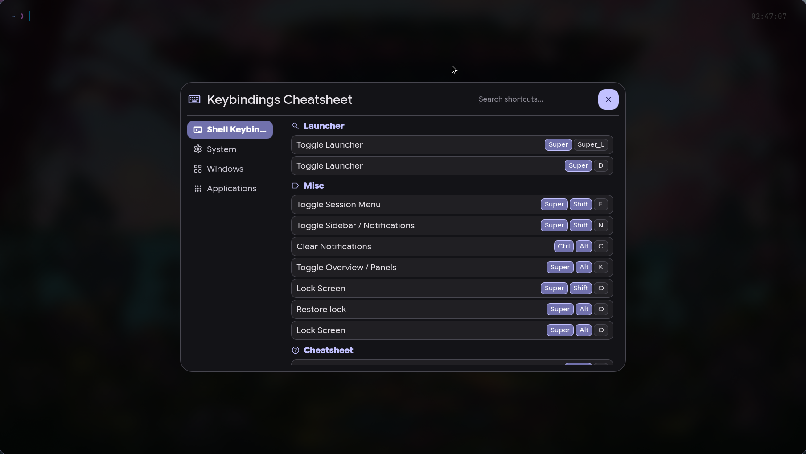
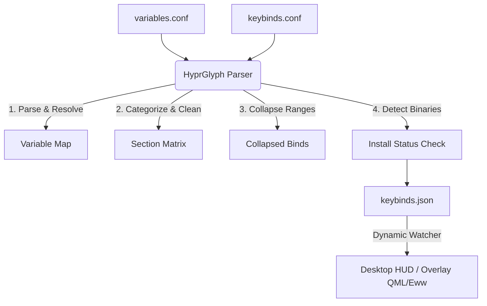

# ⌨️ HyprGlyph

[](https://www.gnu.org/licenses/gpl-3.0)
[](#testing)
[](https://hyprland.org)

**HyprGlyph** is a clean, lightning-fast, and automated keybinding parser and cheatsheet generator for the Hyprland compositor. 

Instead of maintaining duplicate cheatsheet tables that go out of sync every time you modify your window manager config, **HyprGlyph** extracts keybindings dynamically directly from your configuration files. It resolves variables, filters out system actions, groups related shortcuts, and outputs a structured JSON schema ready to power stunning desktop overlays (like QML, Eww, or AGS drawers).

---

## 📸 Preview


*Drop a screenshot of your riced cheatsheet window in `assets/screenshot.png` to showcase the interface on GitHub & r/unixporn!*

---

## ✨ Features

*   **Recursion-Safe Variable Resolution:** Automatically parses your `$variable` definitions and recursively resolves nested references (with built-in circular dependency protection).
*   **Intelligent Auto-Routing:** Inspects binds on the fly and dynamically groups them into clean logical sections (`Windows`, `Applications`, `Utilities`, `System`, `Shell`) based on keywords and syntax signatures.
*   **Smart Range Collapsing:** Automatically detects numeric bindings sequences (like `Super + 1` through `Super + 0`) and collapses them into clean single entries (e.g., `Super + 1-10` ➔ `Switch to Workspace 1-10`) to prevent UI clutter.
*   **Desktop Package Detection:** Leverages `shutil.which` to scan system binaries for `exec` dispatchers, flagging shortcuts for applications that aren't installed on the local system (ideal for rices shared across machines).
*   **Atomic Output Safety:** Writes output atomically utilizing temporary file swapping, eliminating JSON corruption risks and preventing UI flickering in active watchers.
*   **Friendly Description Fallback:** Automatically translates raw window manager actions into readable friendly labels (e.g., `workspace, +1` becomes `Switch to Next Workspace`) if no inline comment exists.

---

## 🛠️ How it Works



---

## 🚀 Installation & Setup

### 1. Clone the repository
Clone this project into your local development or projects folder:
```bash
git clone https://github.com/YourUsername/hyprland_cheat_sheet.git ~/programming/projects/hyprland_cheat_sheet
```

### 2. Configure defaults or environment variables
By default, the script looks for your configuration files under `~/.local/share/caelestia/` and outputs to `~/.local/state/caelestia/keybinds.json`.

You can override these paths using CLI arguments or environment variables:
```bash
export CAELESTIA_VARIABLES_CONF="/path/to/variables.conf"
export CAELESTIA_KEYBINDS_CONF="/path/to/keybinds.conf"
export CAELESTIA_KEYBINDS_JSON="/path/to/output.json"
```

---

## 📖 CLI Usage

Run the parser directly using python:
```bash
python3 parser/parse_keybinds.py \
  --variables ~/.config/hypr/variables.conf ~/.config/hypr/scheme/current.conf \
  --keybinds ~/.config/hypr/hyprland/keybinds.conf \
  --output ~/.local/state/caelestia/keybinds.json
```

### Options
*   `--variables`: One or more paths to configurations declaring variables (e.g. `$terminal = kitty`).
*   `--keybinds`: Path to the main keybindings configuration file.
*   `--output`: Output location for the generated cheatsheet JSON.

---

## 📝 Documenting Your Keybinds

The parser extracts keybindings and attempts to generate friendly descriptions automatically. To customize what is shown in the cheatsheet, you can add comments to your config:

### Inline Comments (Highest priority)
Add a comment preceded by whitespace at the end of a bind line:
```ini
bind = Super, Return, exec, alacritty # Open terminal emulator
```

### Block Comments (Fallback)
The parser associates comments immediately preceding a binding to its description:
```ini
# Switch focus to the next window
bind = Super, J, cyclenext,
```

### Explicit Sections and Categories
To group keybindings under custom sections, prefix blocks with special header comments:
```ini
# ## Shell keybinds
# Category: Launcher
bind = Super, D, global, caelestia:launcher
```

---

## 📦 JSON Schema Output

The generated structured JSON follows a simple nested structure:
```json
[
  {
    "section": "Shell Keybinds",
    "categories": [
      {
        "category": "Launcher",
        "keybinds": [
          {
            "mods": ["SUPER"],
            "key": "D",
            "action": "global, caelestia:launcher",
            "desc": "Open launcher",
            "notInstalled": false,
            "appName": ""
          }
        ]
      }
    ]
  }
]
```

---

## 🧪 Testing

The repository comes with a comprehensive test suite (65+ tests) verifying parser edge cases, recursion limits, stress layouts, and output atomicity.

To run the test suite, install `pytest` and execute:
```bash
pip install pytest
pytest
```

---

## 📄 License
This project is licensed under the GPL-3.0 License. See the [LICENSE](LICENSE) file for details.
